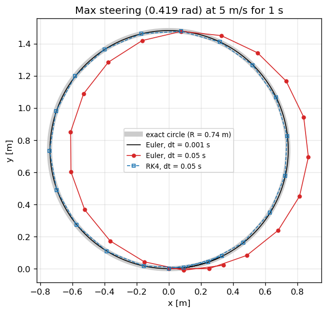

# Lab 8: Model Predictive Path Integral Control

## Simulation video link (your MPPI tracking waypoints in Levine in the simulator, with the sampled rollouts visible in RViz)
[FILL ME IN](https://tinyurl.com/22mts2ax)

## Real-car video link (your MPPI tracking waypoints in Levine hallway on the car)
[FILL ME IN](https://tinyurl.com/22mts2ax)

## Bonus (optional)

### Euler vs RK4

The same control sequence (max steering, 0.419 rad, at 5 m/s for 1 s, `simulate()` of `mppi_node.py`) rolled out with Euler and RK4 at our $\Delta t = 0.05$ s, and with Euler at $\Delta t = 0.001$ s. The exact path is a circle of radius $L / \tan\delta = 0.74$ m.

| Integrator | $\Delta t$ | Max error | Mean error | Error at 1 s |
| --- | --- | --- | --- | --- |
| Euler | 0.05 s | 25.0 cm | 14.5 cm | 5.8 cm |
| RK4 | 0.05 s | < 0.01 cm | < 0.01 cm | < 0.01 cm |
| Euler | 0.001 s | 0.5 cm | 0.3 cm | 0.1 cm |

Euler moves each step along the heading at the start of the step, so it traces a polygon pushed outward from the circle: the error is about $v\,\Delta t / 2$ (12.5 cm) on average and up to $v\,\Delta t$ (25 cm). That is the width of the car, and it is in the tight corners, where the car is closest to the walls, that it matters. RK4 at the same $\Delta t$ is on the circle; Euler needs 50 times more steps to get within 0.5 cm.

RK4 costs four evaluations of $f$ per step: one MPPI update (1024 samples, 20 steps) takes 6.2 ms against 4.5 ms with Euler on our machine, both well inside the control period. In closed loop the two drive the same (three laps of Levine at 18.9 s for both, 5-6 cm RMS lateral error), because the feedback corrects the model error at every step and the simulated car is not exactly kinematic anyway. We kept **RK4** (`INTEGRATOR = "rk4"`, ROS parameter `integrator`): the rollouts the costs are computed on are where the car actually goes, at no cost we can see in the lap.

### Truncated proposal distribution
`sample_controls()` in `mppi_node.py` implements three samplers (`SAMPLING`, ROS parameter `sampling`):

- `clip`: Gaussian around $U$, clipped to the bounds (the baseline).
- `truncated`: Gaussian truncated to the bounds, by the inverse CDF: $z \sim \mathcal{N}(0, 1)$ is mapped to $\Phi^{-1}\left(\Phi(a) + \Phi(z)(\Phi(b) - \Phi(a))\right)$ where $[a, b]$ are the bounds in units of std around $U$.
- `uniform`: uniform on $[U - \sqrt{3}\sigma, U + \sqrt{3}\sigma]$ (same std as the Gaussian) intersected with the bounds, from $\Phi(z)$.

All three start from the same noise $z$, which is correlated over the horizon ($z_t = \rho z_{t-1} + \sqrt{1 - \rho^2}\,\varepsilon_t$, $\rho = 0.9$). The inverse CDF keeps each input exactly truncated-normal (or uniform) while keeping that correlation. We correlate the noise because at rest the steering of the first step has no effect ($\dot\theta = v \tan\delta / L = 0$): with white noise, the first steering command from a standstill came out the right way only about 45% of the time, against 96% with correlated noise.

Share of the samples that land exactly on a bound, with the mean at 0 and near the limits:

| Sampler | Mean at 0: $a$ / $\delta$ on a bound | Mean at $a = -2.5$, $\delta = 0.35$: $a$ / $\delta$ on a bound |
| --- | --- | --- |
| clip | 4.4% / 0.4% | 37.4% / 31.1% |
| truncated | 0% / 0% | 0% / 0% |
| uniform | 0% / 0% | 0% / 0% |

Clipping wastes a third of the samples near the limits on the same input (the bound), so they all explore the same thing, and the update is biased toward the bound. Truncating spreads them over the valid range instead. In closed loop on Levine the three complete the three laps with no collision and similar lap times (18.8 to 18.9 s), with 6.3 cm RMS lateral error for `clip`, 6.4 cm for `truncated` and 5.6 cm for `uniform`: the differences are within what we see between runs. We kept the **truncated** Gaussian: every sample is a valid input, and it stays concentrated around $U$ like the Gaussian MPPI is derived for, where the uniform spreads evenly up to $\sqrt{3}\sigma$.

### Covariance update
`mppi_update()` computes the weighted covariance of the samples at each step, $\Sigma_t = \sum_k w_t^k (u_t^k - U_t)(u_t^k - U_t)^\top$. The truncated sampler draws each input independently, so we keep its diagonal (the weighted variance of $a$ and of $\delta$ at each step). The new std is blended with the previous one ($\alpha = 0.5$), clipped to $[\sigma_{\min}, \sigma_0]$ so the search never collapses, and warm started like $U$ (shifted, with $\sigma_0$ appended). It is on by default (`COV_UPDATE`, ROS parameter `cov_update`, used through `mppi_step_cov()`). On Levine it is the change that mattered most: 18.9 s laps against 26 s with the fixed std, since once MPPI has found a good sequence, the samples concentrate around it instead of adding noise to the throttle.

### Waypoints and constraints
- The waypoints (`mppi/waypoints/*.csv`, made by `tools/gen_waypoints.py`) are the map centerlines smoothed toward minimum curvature while keeping 0.55 m from the walls, resampled every 0.1 m, with a speed profile limited to 5 m/s² lateral and 2.5 m/s² longitudinal acceleration. Our MPC waypoints asked for up to 22 m/s² lateral acceleration in the Levine corners, more than the tires of the simulated car can give, and MPPI followed them into the wall.
- Inputs stay within bounds by construction (sampling above). The speed is clipped to `[MIN_SPEED, MAX_SPEED]` inside the rollouts too, like the published speed, so a car at rest does not plan to reverse.
- The position error of the cost is split into lag (along the reference) and lateral error, weighted 1 and 20: from rest the reference runs ahead of the car, and a plain x/y error is then mostly lag, which only the throttle can fix.
- The reference speed ramps up from the current speed at `MAX_ACCEL`, so the reference stays where the car can actually be.
- Odometry comes at 250 Hz, much faster than $\Delta t$, so the warm start shifts $U$ by the time elapsed since the last odometry, not by a whole step.
